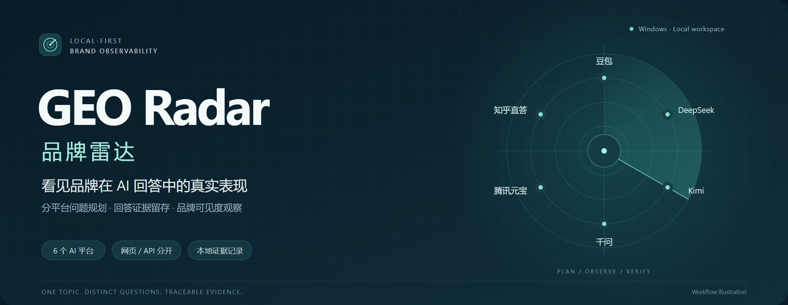
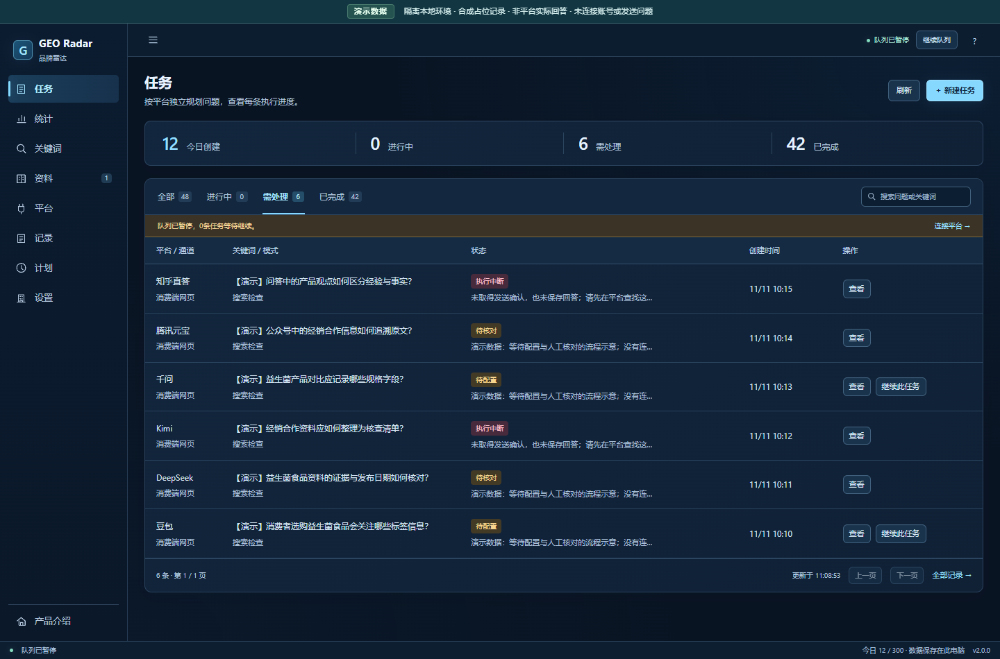
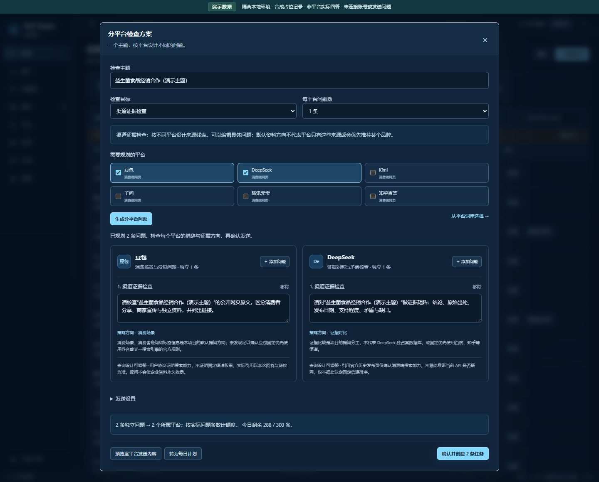
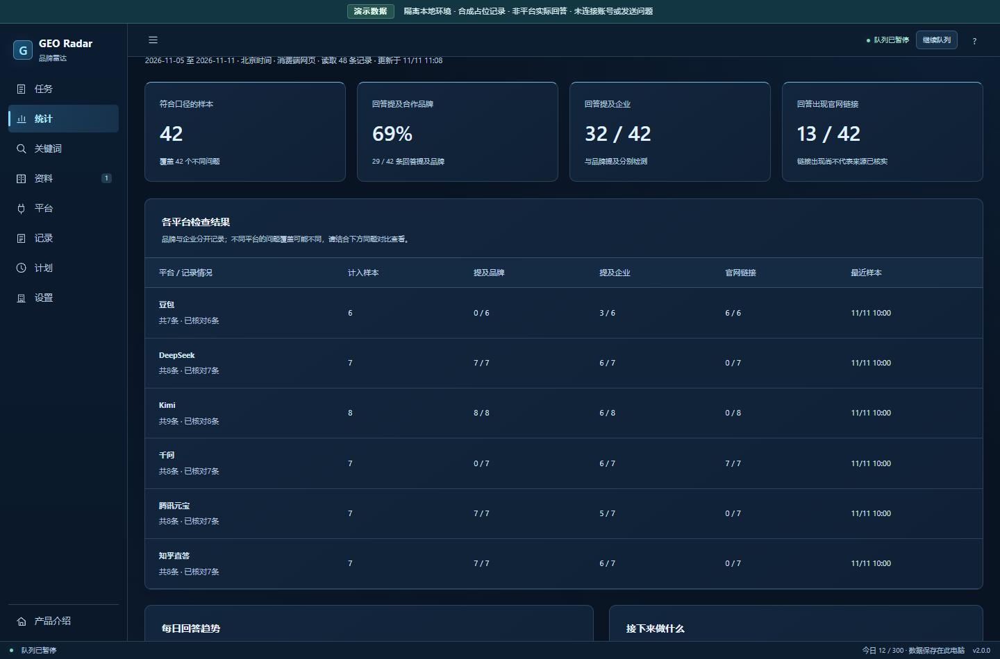
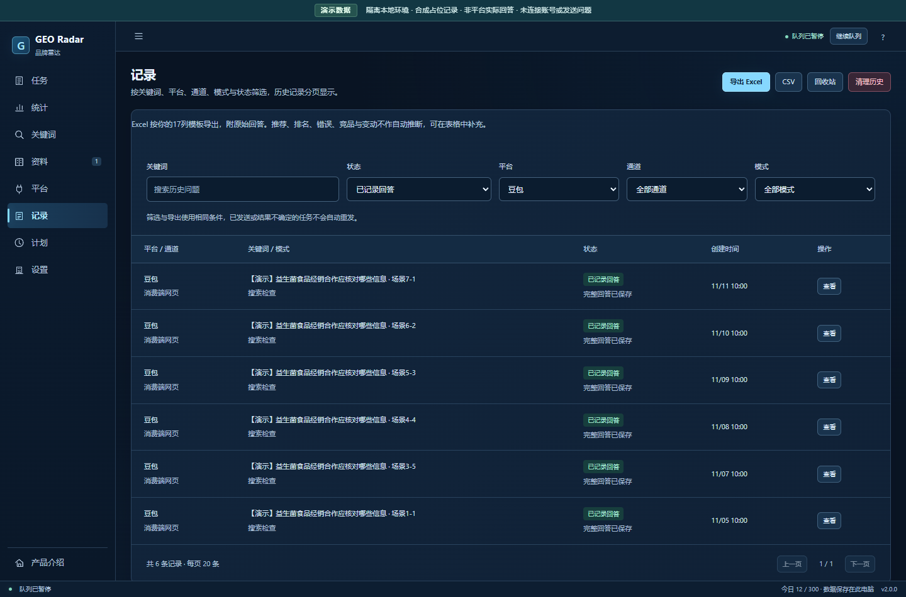
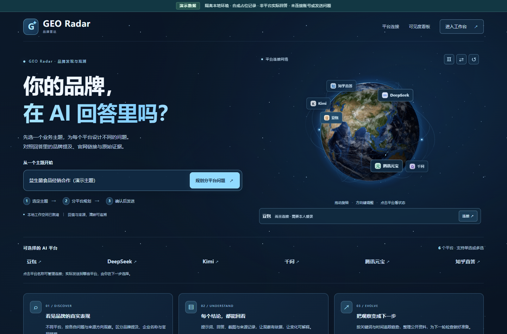

# GEO Radar · 品牌雷达

**分平台问题规划 · 回答证据留存 · 品牌可见度观察**



    

面向生成式搜索的多平台品牌可见度观察工作台。围绕一个业务主题，为六个平台独立规划问题，保留实际提示词、回答、截图与来源，分别观察品牌、企业名称和官网链接的出现情况。

[界面导览](#界面导览) · [快速启动](#启动与首次使用) · [架构与指标](docs/architecture.md) · [检查与优化记录](docs/project-review-2026-11-11.md)

## 界面导览

以下均由项目真实界面渲染，使用隔离的演示企业、演示记录与统计占位内容。截图不包含真实平台回答或账号，图中的数字用于展示界面，不代表品牌效果。复现方式见[截图说明](docs/images/showcase/README.md)。

### 工作区：任务、队列和当天额度



任务按进行中、需处理、已完成分组；每条问题绑定自己的平台，队列状态、发送间隔与创建额度可以回看。

### 规划：一个主题，各个平台独立提问



本地模板生成问题卡片，可逐条编辑并预览完整提示词；确认创建后才进入执行队列。

### 观察：分开统计品牌、企业与官网链接



网页与 API、自然发现与指名核对分别观察。不同问题的回答不作为平台推荐排名。

### 回看：筛选记录、核对回答、导出证据



保留实际问题、回答、来源与状态；支持 Excel、CSV、Markdown 报告和可恢复的历史清理。

### 产品首页：交互式地球与平台连接网络



地球与卫星轨道是本地视觉演示；节点用于查看连接状态，执行目标以已确认的问题卡片为准。

## v2.0.1：采集与连接可靠性

- 豆包长回答的原问题可能被虚拟列表卸载；采集会在消息列表内部恢复原问题并精确匹配相邻回答，随后恢复原滚动位置，草稿不变。“重新获取”与自动采集共用提取器，不按最后一条回答猜测。
- 兼容 DeepSeek 的非原生新对话入口；点击文字、快捷键或图标会归一到同一控件，标定时不触发原点击。
- 识别登录、安全验证、限流及知乎登录页10001错误后停止自动操作，由本人处理后检查连接并手动继续。连接失败使用30–300秒退避，不反复刷新现有登录页。

详见[平台连接与采集说明](docs/platform-reliability-v201.md)。这些措施用于减少无效重试，不承诺避免平台验证，也不包含指纹伪装、代理轮换或验证码绕过。

## v2.0.0：从统一分发改为分平台规划

每条任务明确绑定一个平台与一个问题，不再把共享问题自动发给所有平台。豆包、DeepSeek、Kimi、千问、腾讯元宝和知乎直答分别维护关键词库、问题草稿和每日计划快照。每批最多30条、每个平台最多5条，额度按实际任务条数计算。

| 平台 | 默认问题方向 |
| --- | --- |
| 豆包 | 消费选择场景、产品说明与常见疑问 |
| DeepSeek | 原始证据、信息矛盾与比较依据 |
| Kimi | 文档调研、资料完整性与信息缺口 |
| 千问 | 产品规格、标签字段与选品比较 |
| 腾讯元宝 | 公众号、视频号等微信生态的可访问公开线索 |
| 知乎直答 | 问答观点、消费经验与原始依据 |

这些方向是本项目的查询设计，不是平台固定信源、独占索引或推荐排名规则。元宝公开说明支持公众号和视频号信源，不意味着优先推荐腾讯旗下企业。每个平台的官方能力依据、产品范围与策略假设在关键词页分别展示，详见[平台策略与证据](docs/platform-strategies.md)。

问题草案由本机模板结合企业设置生成，不调用模型、不制造实时热词或搜索量。可以逐条修改实际问题；资料方向标签当前只读，避免保存一个方向却执行另一个方向。

## 启动与首次使用

需要 Windows 10/11、Python 3.10–3.13 和 Microsoft Edge。解压后双击 `start.bat` 或 `open_client.bat`；首次安装依赖需要网络。普通浏览器方式使用 `open_browser.bat`，本地地址为 [http://127.0.0.1:8020/](http://127.0.0.1:8020/)。源码包需要 Python 与 Edge，并非免安装 EXE。

1. 在设置页确认公司、合作品牌、业务与官网，资料页只批准确实允许外发的内容。
2. 在平台页打开专用 Edge，由本人登录、处理验证码，检查输入框、发送方式和新对话入口，保存连接。
3. 新建任务，填写业务主题，选择规划目标和平台，点击“生成分平台问题”。
4. 每个平台的问题独立展示。逐条改写或移除，再预览服务端生成的完整提示词。
5. 点击“确认并创建”才创建外部执行任务。关键词整理、草案预览、看板读取均不向平台提问。
6. 在记录与统计页回看证据。关键词页可为六个平台分别保存问题，也可把任务草稿转为每日计划。

不同平台可并行，同一平台顺序执行。平台选择用于生成草案，**实际执行对象以草稿中的平台卡片为准**。首页地球节点只查看本机连接状态，不选择发送目标；地球影像、云层和卫星轨道是本地视觉演示。

## 三种规划目标

| 目标 | 问题与口径 |
| --- | --- |
| 来源核验 | 针对平台的资料线索追溯原文、主体、日期与链接；不计入自然发现 |
| 自然发现 | 使用不带本企业、品牌、官网的行业或客户问题；不指定资料渠道 |
| 品牌信息核对 | 直接询问品牌与企业信息；与自然发现分开统计 |

资料研读可附上已批准的资料，与独立公开搜索分别记录。品牌提示、资料研读、连续会话和来源核验不计入自然发现。自动校验只判断问题与回答对应、正文非空和生成结束，不验证回答中的事实、功效或来源真实性。

分平台问题的措辞与意图不同，不能据此比较推荐排名。看板按实际问题展示覆盖情况；同题空格表示没有对应样本。文字提及不等于正向推荐，正文官网地址不等于引用官网，发送资料不等于永久收录。

## 每日问题与每日执行计划

关键词页的每日整理只在本地按平台生成、去重并保存问题，不发送到外部平台。新每日执行计划保存明确的问题与平台快照，默认不启用；核对后自行启用，按北京时间每日最多触发一次。关机、休眠或退出登录期间不运行，不补跑历史日期。

本版本首次升级会暂停旧版共享分发计划，保留其配置供参考；不会删除旧问题、历史回答或浏览器资料。请检查平台卡片，建立新的独立问题计划。定时计划的执行日期和任务创建一起提交，额度不足不会消耗当天执行机会。

## 采集、导出与历史记录

- 保留真实草稿，不自动清空编辑器。灰色占位提示和零宽空编辑结构不再误判为草稿；实际文字、提及标签和附件仍受保护。豆包已确认的空欢迎页不再冗余点击新对话。
- 发送前准备、发送尝试、发送确认和回答采集分别记录。结果不确定的历史请求不自动重发；准备失败只有确定未发送时才允许人工继续。
- 空回答不能人工保存。旧详情请求不能覆盖新弹窗中的记录。
- Excel 主表保留17列模板，另附完整提示词、原始回答和来源；CSV 与报告可单独导出。
- 历史清理先预览再移入回收站，可恢复；恢复记录不会重新发送，也不返还当日创建额度。

[回答与采集修复历史](docs/execution-reliability-v194.md) · [空回答保护](docs/answer-review-v193.md) · [导出与回收站](docs/records-export-and-trash.md) · [指标与关键词](docs/measurement-and-keywords.md)

## API 与后台

复制 `.env.example` 为 `.env`，只在本机填写 Key，重启后选 API 通道及实际可用模型 ID。

| 平台 | 环境变量 |
| --- | --- |
| 豆包／火山方舟 | `ARK_API_KEY` |
| DeepSeek | `DEEPSEEK_API_KEY` |
| Kimi | `MOONSHOT_API_KEY` |
| 千问 | `DASHSCOPE_API_KEY` |

元宝、知乎提供网页通道。API 与消费端网页分别统计；模型 API 不一定具有 App 的联网能力，来源策略不能赋予 API 本来没有的搜索工具。

后台按当前 Windows 用户登录自动启动，由监管程序恢复 HTTP 进程；页面自动重连。验证码或登录失效仍需本人处理。临时停止使用 `stop_background.bat`；取消登录自启并停止使用 `disable_autostart.bat`。详见[后台说明](docs/background-service.md)。

## 数据保留与验证

2026-11-11 本地检查修复了定时调度异常退出、提交期间草稿丢失、刷新重试重复创建、本机 Host 校验和特殊字符导出问题。修改内容、验证范围与后续优化建议见[项目检查记录](docs/project-review-2026-11-11.md)。

升级保留 `runtime` 与本机 `.env`。分发包不含数据库、实际平台截图、Cookies、密钥或虚拟环境。任务提示词在创建时固定，后续资料修改不改写历史。

```powershell
.\.venv\Scripts\python -m unittest discover -s tests -p "test_*.py" -v
.\.venv\Scripts\python tests\browser_capture_checks.py
.\.venv\Scripts\python tests\editor_content_checks.py
.\.venv\Scripts\python tests\ui_submission_checks.py
.\.venv\Scripts\python tests\doubao_capture_checks.py
.\.venv\Scripts\python tests\new_chat_control_checks.py
.\.venv\Scripts\python tests\page_guard_checks.py
```

2026-11-11 本地检查通过239项单元／HTTP测试，覆盖分平台路由、禁止统一分发、去重、幂等、额度、定时计划原子提交、异常恢复、本机访问校验、迁移与原有记录管理。另有6项提交交互回归、12个编辑器内容场景、4个豆包空欢迎页场景及21个回答关联 DOM 场景检查通过。页面流程使用隔离数据验证。本轮未向真实 AI 平台重新发送问题，不代表六个平台实站均已完成端到端发送验收。
