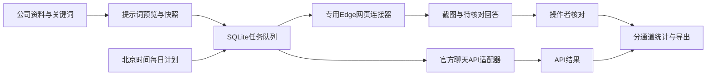

# 架构与指标

## 任务与状态

queued → running → waiting_setup / sent / needs_review / completed / failed / uncertain / interrupted。

- waiting_setup：没有发送，缺登录、控件、Key或模型；允许用户准备好后重新排队。
- sent：已经执行发送动作，但未取得可核对的完整回答，不等于完成。
- needs_review：网页自动截取到回答，等待人工核对。
- completed：API返回回答，或网页操作者核对保存。两者分开统计。
- uncertain / interrupted：超时、中断或浏览器操作结果不确定，不自动重发。
- cancelled：仅允许取消未发送的queued/waiting_setup任务。

批次请求编号唯一，并核对请求内容摘要。数据库事务保护任务数量、每日额度及批次写入。重启把running改为interrupted；不会静默再次发送。

## 指标

统计只包含visibility模式、已核对/记录、且关键词不带企业名称、别名或域名提示的样本。资料研读和品牌词问题排除。网页与API独立计数。

品牌提及：文本包含已配置企业名称/别名。官网链接：解析文本HTTP(S)链接后主机与配置域名匹配，避免把junheprobio.com.evil.example计为官网。

这些是文本检测，不证明来源真实、引用成立、账号无个性化、模型永久记忆、搜索引擎收录或公众排名。用户核对也不能替代外部事实验证。API请求未配置联网能力时不得解读为搜索引擎测试。

## 浏览器

独立Edge持久化目录，手动登录、点选CSS控件，无登录凭据导出、不绕验证码。仅对已配置平台页面执行输入和发送，不调用知乎公共发布入口。搜索检查必须配置新对话按钮；账号记忆或开关状态需由操作者核对。

回答稳定性通过文本相同次数判断，可能截取不完整，因此网页回答需要人工核对。自定义控件仍可能随页面改版失效，不能保证六平台所有页面状态都通用。

## 服务范围

本机单用户，绑定127.0.0.1；变更接口要求同源及自定义请求头，避免普通第三方网页直接驱动本机发送。没有公网鉴权、多人租户和云端调度。Key只从环境读取，运行目录与.env不打包。

每日计划本地执行，电脑休眠/关机或服务关闭时不运行。服务晚启动仅补当日一次，超额度会记录计划提示，不扩大限制。
