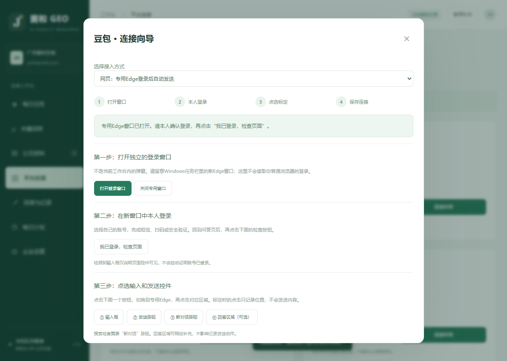

# v1.0.1 连接修复与操作指引

## 修复

“打开登录”原来提交空JSON对象，但后端为所有浏览器操作统一要求kind字段，导致FastAPI在启动浏览器前返回422。现在kind仅在点选操作时校验，连接、检查、关闭和点选结果轮询均接受空对象。

新增对六个平台按钮接口的回归覆盖，避免仅测试底层浏览器而漏掉实际HTTP请求。加载网页超时会保留专用窗口、返回可见的加载提示，并允许刷新/重试，不把加载问题伪报为登录成功。

## 网页连接四步

1. 打开“平台连接” → 选豆包等平台 → “连接向导” → “打开登录窗口”。
2. 在新开的专用Edge窗口本人完成登录，再回工作台点“我已登录，检查页面”。普通浏览器已登录不等于专用窗口已登录。
3. 依次点选输入框、发送按钮、新对话按钮；回答区域可稍后补充。点选只记录控件，不发送。
4. 向下滚动到第四步，勾选允许自动发送，点“保存连接配置”。回“每日任务”，先只勾选这个平台测试1个关键词。

网页模式不需要API Key；API模式才需要本机Key和控制台模型ID。所有验证码、扫码和账号确认仍由本人完成。

## 实际验证

- 33项自动化通过，包含空请求、六平台路由、错误提示、导航超时保留窗口和恢复检查。
- 前端浏览器验证四步向导、空对象请求、网页/API切换、未标定保护、持续显示错误和手机尺寸。
- 对当前服务实际提交豆包connect请求：返回200，专用Edge加载到https://www.doubao.com/chat/，login_verified保持false。
- 这仅验证窗口打开，不宣称完成用户登录、验证码或真实任务发送。
