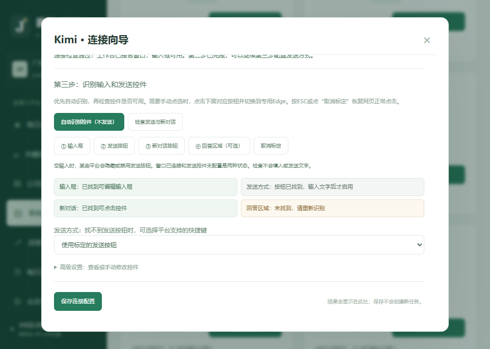
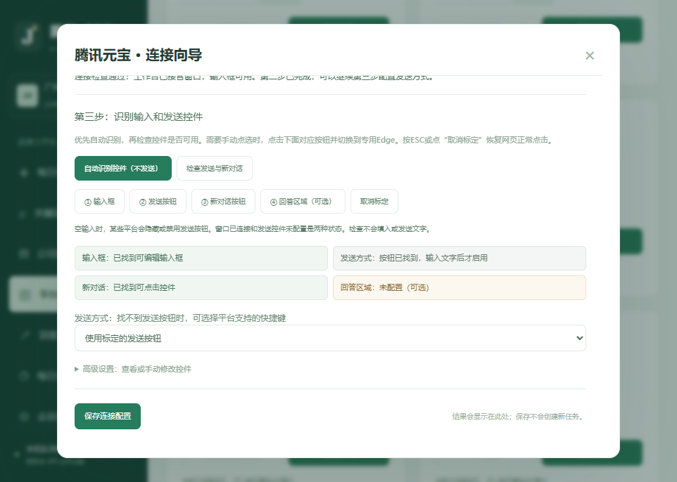

# v1.0.4 连接状态与发送按钮识别

## 第二步已经识别到窗口

“窗口已连接、输入框可编辑”说明工作台已经接管该平台窗口。第三步的发送按钮未配置，不影响第一、二步的窗口连接。旧版把这些信息挤在一行，容易误认为第二步失败。

现在分开显示窗口、输入框、本人登录确认和发送方式。点“我已登录，检查页面”后，如果窗口和可编辑输入框都存在，就显示第二步检查通过。此按钮记录的是操作者本人确认；程序仍不会冒称从输入框检测就验证了账号登录。

## Kimi的发送图标修复

旧规则可能记录到内部SVG图标，甚至误把输入框当作发送按钮；仅仅写了规则就显示“已记录”。现在会检测实际目标类型，并将图标归一到可点击的外层控件。

实际Kimi页面已修正为输入框`div.chat-input-editor`、发送控件`div.send-button-container`和原有新对话入口。腾讯元宝也已检测并保存可编辑输入框、带“发送”标签的控件及新对话入口。

## 状态怎么读

| 显示 | 含义与操作 |
| --- | --- |
| 窗口已连接 | 当前工作台已接管这个专用窗口 |
| 规则已填写，尚未检测 | 只填了规则，尚不能认为可用 |
| 按钮已找到，输入文字后才启用 | 控件已识别；输入框为空时禁用属于平台正常行为 |
| 空输入时未找到，输入文字后再检查 | 平台可能隐藏了控件，尚不能认定规则有效；可本人输入文字后再检查 |
| 只命中图标 / 选中了输入框 | 需要重新识别外层按钮，不能作为发送配置通过 |
| 使用Enter或Ctrl+Enter | 操作者明确选择了快捷键，不再把“没配置按钮”当作快捷键失效 |
| 当前页未匹配回答（可选） | 等平台出现回答后再检查或标定，不影响窗口连接 |

## 操作

1. Ctrl+F5刷新工作台，进入对应平台连接向导。
2. 在第二步检查窗口与输入框；在第三步点“自动识别控件（不发送）”。
3. 查看各项实际状态，也可以点“检查发送与新对话”。识别仅填写建议，不输入文字、不点击发送、不自动保存或授权发送。
4. 需要时本人确认登录、勾选允许自动发送并保存。元宝原来的未启用状态保持不变，保存的识别规则为草稿；不会替你勾选发送授权。

## 验证范围

51项单元/HTTP测试通过。本地真实Edge测试覆盖输入框误选、SVG归一、空输入禁用状态和诊断不发送。浏览器界面验证窗口状态与发送状态分开、迟到的其他平台检测结果不能覆盖当前弹窗、固定关闭按钮及窄屏显示。

本机真实Kimi、元宝页面均检测到可编辑输入框、发送控件和新对话；当时输入框为空，两个发送控件均为待输入状态。此次仅做控件检查和配置修复，没有新增或重试任务，也没有向这两个平台发送新问题。回答获取及完整实发应另行验收，不能把控件检测当成全部平台测试已通过。
