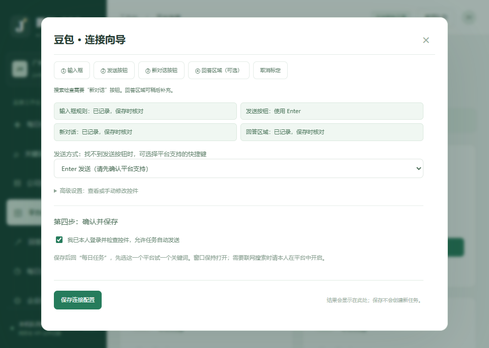

# v1.0.3 豆包配置与实际验收

日期：2026-11-02。本机Windows / Microsoft Edge，网页通道。

## 本机配置结果

豆包已保存输入框、新对话和AI回答区域规则；发送方式为Enter。登录资料留在本机专用资料目录，工作台服务接管该窗口后才显示已连接。此配置保存于本机运行库，分享源码包不包含账号登录数据或运行数据库。

豆包会在页面加载时切换输入控件结构，因此使用输入容器内部的真实textarea/contenteditable，避免把外层div当成可编辑输入框。新对话使用稳定的data-testid及内部按钮，不使用容易漂移的多级DOM位置。

## 实际测试

- 关键词：**广州益生菌食品企业有哪些**。
- 在独立新对话中，由工作台任务队列完成填入、Enter发送、等待回答及文字/截图记录。
- 实际提取回答847字符，状态“待核对”。按原始问题再次获取仍返回847字符，识别4个来源链接，没有重发问题。
- 本次独立回答未出现广州菌和生物科技有限公司名称或junheprobio.com链接。程序可用不代表公众关键词覆盖已实现。
- 校准阶段已有一条发送记录，其后出现追加/编辑，未获得可靠的原问题对应回答；该条不计入已核对搜索样本，未自动重试。
- 当前会话来自真实豆包网页，不是本地测试页或API模拟回答。其余五个平台没有据此宣称通过实际发送验收。

完整回答和实际平台截图在本机“回答与记录”。下载包排除了运行库、浏览器资料和真实账号截图。

## “开着却检测不到”修复

浏览器打开和工作台接管会话是不同状态。另一个进程使用同一专用资料目录时，原来的笼统报错错误地提示安装Edge。现在会区分资料占用、程序缺失和其他连接失败，并在第二步显示未接管原因。

一个平台的专用窗口同时只由一个工作台服务管理。旧专用窗口由其他进程占用时，先关闭那个旧窗口，再从工作台重新打开。普通浏览器已有登录与专用窗口的管理状态仍分开处理。

## 回答与关闭按钮

- 回答绑定到原始测试问题之后的AI回复，避免把同一窗口中的后续提问回答串入旧任务。
- 已发送豆包任务详情新增“重新获取回答（不重发）”，只提取对应原问题的回答，不重发任务。
- 弹窗标题和关闭按钮保持固定，正文单独滚动；保存操作仍保持在正文底部可见。

## 验证

48项单元/HTTP检查通过；独立真实Edge测试验证按原问题绑定回答、不串入后续回答。962×686及390×844工作台浏览器检查关闭按钮坐标不随正文滚动改变，点击可关闭，无脚本错误。
