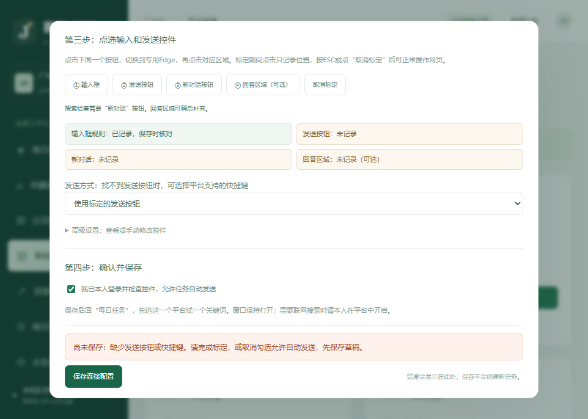
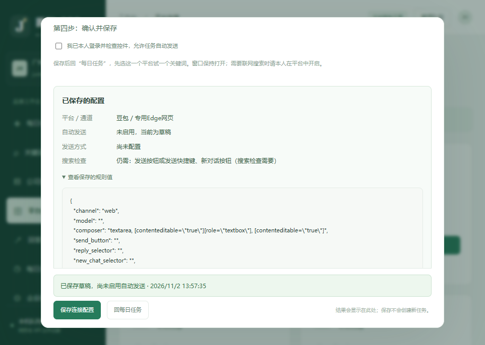

# v1.0.2 输入框显示与保存反馈修复

## 为什么原来有问题

专用Edge原来模拟1280×900的固定页面视口。在实际窗口高度不足900像素时，平台底部固定的输入框可能位于物理窗口下方。程序能找到控件，不代表使用者看得到。

保存时还存在另一个问题：没有发送按钮或快捷键，却勾选了允许自动发送。原校验通过页面外的toast显示，原生dialog位于更高显示层，挡住了错误提示，所以看起来像没有响应。

## 现在怎么操作

1. 刷新工作台；仍显示旧界面时按Ctrl+F5。
2. 打开“平台连接 → 豆包 → 连接向导”。专用Edge改为使用实际窗口尺寸，不再固定模拟900像素页面高度。
3. 找不到输入框时点“看不到输入框？定位输入框”。它会取消当前标定、滚动到输入框并切换到专用窗口，不会输入或发送文字。网页刚打开时请等页面加载完成。
4. 标定输入框、新对话、发送按钮。发送按钮未显示时，也可明确选择该平台支持的Enter或Ctrl+Enter方式；选择快捷键后会清除旧发送按钮规则，防止继续使用失效按钮。
5. 标定时按ESC或点“取消标定”可恢复网页正常点击。误点普通区域不会再被记录成输入框。
6. 勾选允许自动发送并保存。若未准备好，取消勾选可以先保存草稿。

## 保存后会显示什么

结果直接显示在弹窗内保存按钮上方，滚动时也能看见：

- **尚未保存**：指出缺少发送按钮/快捷键、没有可编辑输入框、窗口未打开或新对话按钮失效等具体原因；失败不会覆盖原配置。
- **已保存草稿**：保留填写的规则，不启用网页自动发送。
- **已保存并启用网页连接**：说明核心控件检查通过且使用者已确认。是否可做搜索检查会单独标注，新对话按钮仍是搜索检查必需项。
- **保存回执**：显示平台、通道、发送方式、保存时间，并可展开查看实际返回的规则值。保存成功不会自动关闭弹窗。

保存只保存配置，不新建任务。已有“待配置”任务也不会因此自动重发；在“回答与记录”核对后重新排队。

## 验证范围

- 41项单元/HTTP测试通过，包含草稿回执、保存前检查、失败不覆盖、未保存规则检查、取消标定和点选不暗中写入配置。
- 独立本地页面上的真实Edge测试通过：原生视口、屏幕外输入框定位、误选拒绝、取消标定、标定不发送及一次受控发送/回答记录。
- 工作台在962×686与390×844尺寸验证：错误在弹窗内可见，草稿返回实际值，无输入焦点跳走，无横向溢出。
- 实际豆包问答页的检查接口返回可编辑输入框且位于窗口内：当次视口1528×686，输入框顶部586、高24像素。此检查未输入或发送内容，也不代替本人确认登录状态。

六个平台真实发送和API计费调用仍需使用者逐个平台验收。
