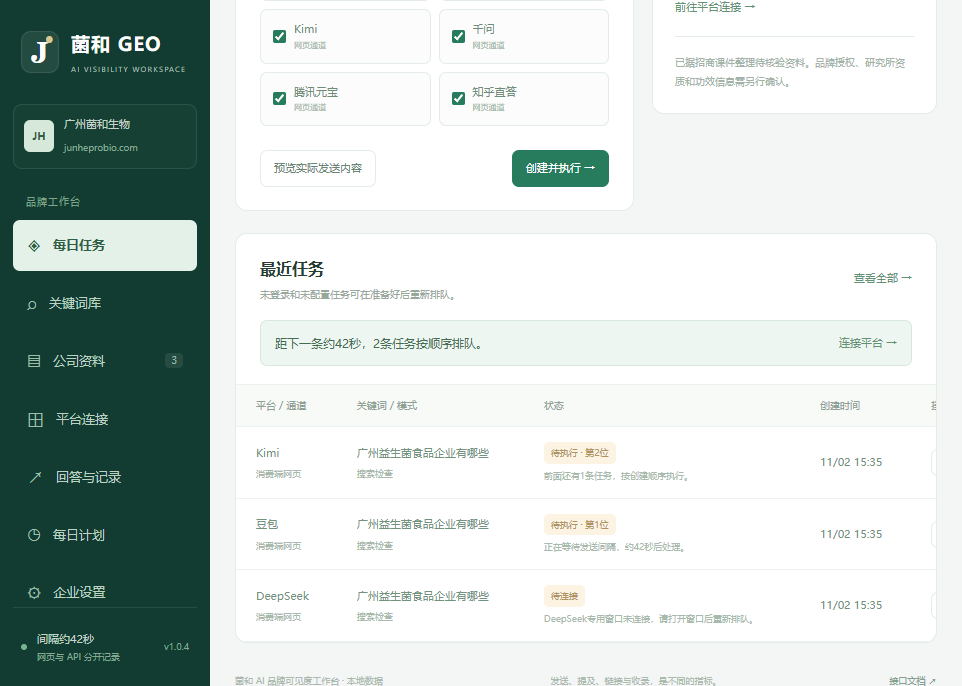
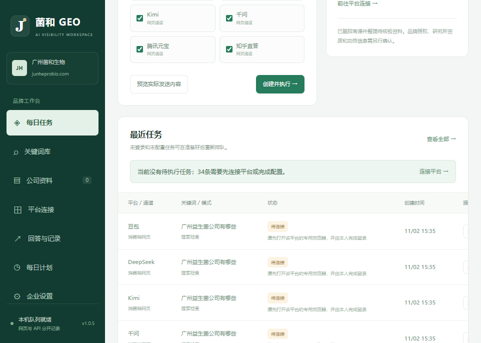

# v1.0.5 排队原因、连接预检与发送间隔

## 为什么一直显示待执行

旧版按创建顺序逐条处理，每处理一条就固定等待45秒。即使任务因为专用窗口没打开而直接返回待配置，也会等待同样的间隔。旧批次和新批次叠加后，新任务可能需要等待较长时间；界面又没有展示排队位置或倒计时，看起来像后台没有工作。

此次现场检查确认执行器仍在运行，记录在持续更新；同时六个平台的专用窗口都未连接。旧队列随后逐条进入待配置，没有把它们误报为已经发送。

## 已调整

- 创建批次后检查未执行的网页任务；窗口未连接、未允许发送、缺少输入或发送方式，以及搜索检查缺新对话入口的任务，会直接标为待连接/配置并说明原因。
- 调度期间也会检查尚未执行的任务。未连接和配置失败不会占用发送间隔，不再让每个缺配置任务额外等待45秒。
- 已发送或结果可能不确定的请求仍保留发送间隔。API网络异常等可能已到达平台的情况不自动重发。
- 近期任务上方显示队列当前状态；待执行任务显示队列位置，队首间隔显示约剩余秒数。暂停、执行器未启动和调度异常都会显示具体提示。
- 本地健康接口提供执行器是否存活、心跳、当前任务、队列数量和间隔状态，不再只表示网页服务能响应。

## 状态与下一步

| 状态 | 含义 | 下一步 |
| --- | --- | --- |
| 待连接 | 该平台的专用窗口未连接到本服务 | 到平台连接打开专用Edge并本人登录，再回任务详情重新排队 |
| 待配置 | 未允许自动发送或缺少必要控件 | 完成控件检查与保存，再重新排队 |
| 待执行·第N位 | 前面仍有任务，或正在等待发送间隔 | 查看上方队列说明，无需重复创建 |
| 执行中 | 正在尝试发送或等待回答 | 保持专用窗口打开，等待该条结束 |
| 队列已暂停 | 使用者暂停了执行 | 在顶部点击继续队列 |
| 待核对 | 已取得回答文字或截图 | 在记录中核对并保存 |

工作台网页开着不等于平台专用窗口仍开着。当前版本需由本人先连接各个平台并保持专用窗口打开；不会为未连接的平台悄悄打开一批登录窗口，也不会自动重试旧的待配置或已发送任务。

## 验证

59项单元/HTTP测试通过，包含一次调度将六个未连接任务分类、间隔期间仍能分类缺连接任务、未准备的平台不阻塞后续可执行平台、配置失败不占间隔、真实尝试仍保留间隔，以及暂停与稳定队列顺序。

浏览器检查排队位置、约剩余秒数、待连接、暂停、执行器异常与窄屏布局。上线后检查本机执行器存活、无后台错误，当前记录显示待连接而非持续待执行。此次维护没有新建、重新发送或删除用户任务。
