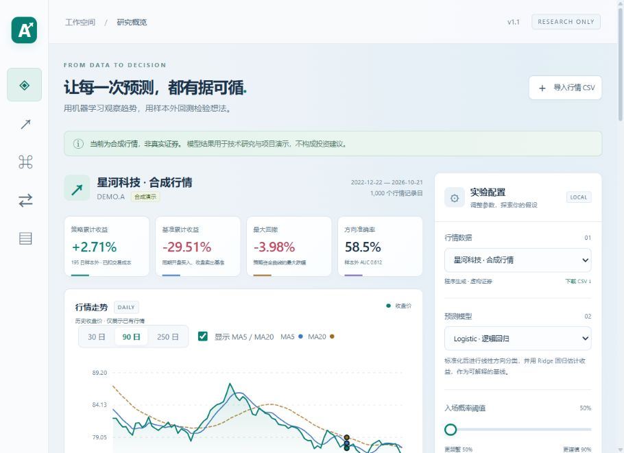

# AI 项目演示合集

三个可以在本地运行的项目，覆盖电商订单分析、多智能体论文辅助和股票趋势研究。每个目录都包含独立源码、启动入口和中文说明，适合学习与面试演示。

## 项目导航

| 项目 | 核心功能 | 主要技术 | Windows 启动入口 |
| --- | --- | --- | --- |
| [知购 · AI 电商增长助手](ai-commerce-copilot/README.md) | 订单 CSV 导入、品类识别、订单检索、复购机会分析 | Python、FastAPI、SQLAlchemy、SQLite / MySQL | `ai-commerce-copilot/start.bat` |
| [学术同行 · 多智能体论文辅助系统](ai-thesis-copilot/README.md) | 六节点研究流程、SSE 状态流、文献检索、草稿、检查点与反馈 | Python、LangGraph、Java / Spring Boot、TypeScript / Vite、Redis；RAGFlow 可选 | `ai-thesis-copilot/run-demo.bat` |
| [AlphaLens · AI 股票研究室 v1.1](ai-stock-lab/README.md) | 行情导入、方向与收益预测、含成本回测、双模型对比、实验记录 | Python、scikit-learn、pandas、FastAPI、SQLite | `ai-stock-lab/start.bat` |

## 开始使用

```bash
git clone https://github.com/keke152/code.git
cd code
```

1. 选择上表中的一个项目，先阅读该项目的 README。
2. 电商和股票项目需要 Python；建议使用 Python 3.10 或 3.11。论文项目还需要 Node.js 20+，完整演示需要 Java 17+ 与 Maven 3.9+。
3. 在相应目录运行启动脚本，首次安装依赖需要联网。
4. 按服务终端提示打开浏览器，演示期间保持服务窗口运行。

| 项目 | 默认页面 |
| --- | --- |
| 电商助手 | `http://127.0.0.1:8000` |
| 论文工作台 | `http://127.0.0.1:5173` |
| 股票研究室 | `http://127.0.0.1:8010` |

电商服务与论文 Python 服务默认都会使用 `8000` 端口，建议分别启动演示；同时运行时需要调整对应服务与前端的地址配置。

## AlphaLens 界面



股票项目当前包含浅色界面、30 / 90 / 250 日行情视图、MA5 / MA20、回撤与月度收益、预测记录筛选、CSV 导出和双模型对比，并修复 Windows 静态脚本 MIME 类型导致的加载与滑杆问题。

### 股票项目文档

- [架构与模型原理](ai-stock-lab/docs/01-architecture-and-model.md)
- [数据与回测公式](ai-stock-lab/docs/02-data-and-backtest.md)
- [API 与配置](ai-stock-lab/docs/03-api-and-configuration.md)
- [面试演示讲稿](ai-stock-lab/docs/04-demo-and-interview.md)
- [交付内容与运行记录](ai-stock-lab/docs/06-delivery-notes.md)
- [v1.1 功能更新说明](ai-stock-lab/docs/07-v1.1-update.md)

电商和论文项目的架构、接口、操作步骤与演示讲解，分别位于其目录内的 README。

## 演示范围

- **电商：** 使用虚构订单和可解释的关键词分类、购买间隔规则；没有登录或爬取真实商家平台，也没有将规则得分作为已校准概率。
- **论文：** 默认使用虚构语料和离线草稿生成器。外部模型及 RAGFlow 需要自行配置，引用与学术结论需要核对原始来源。
- **股票：** 使用真实训练的分类 / 回归模型，默认行情为合成数据。目标是下一条日线的开盘至收盘收益；不提供实时行情或自动交易，也不保证未来走势。当前日内执行假设不能直接用于普通 A 股 T+1 股票交易。

项目均面向本地演示。已有的运行记录与未验证范围见项目文档；不将演示描述为经过完整测试的生产系统。

## 仓库内容与本地数据

仓库包含源码、依赖清单、配置示例、虚构样例数据与说明文档。依赖环境、编译结果、日志、运行数据库、上传的行情和实际 `.env` 文件由各台电脑自行生成，已配置 Git 忽略规则。配置外部服务时保留示例文件，将实际凭据存放在本地环境变量或不提交的配置中。

从旧目录迁移时，先单独备份需要的运行数据；仓库源码不能代替实验数据库与用户文件的备份。
