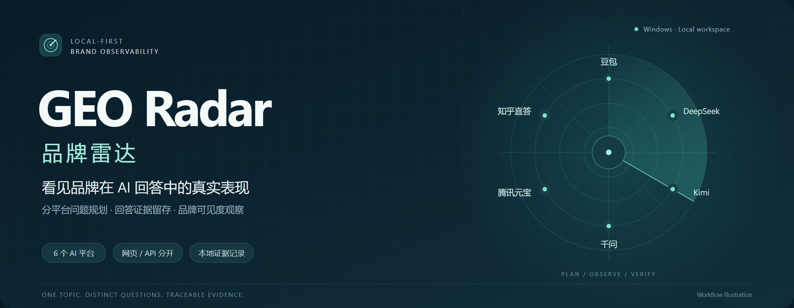
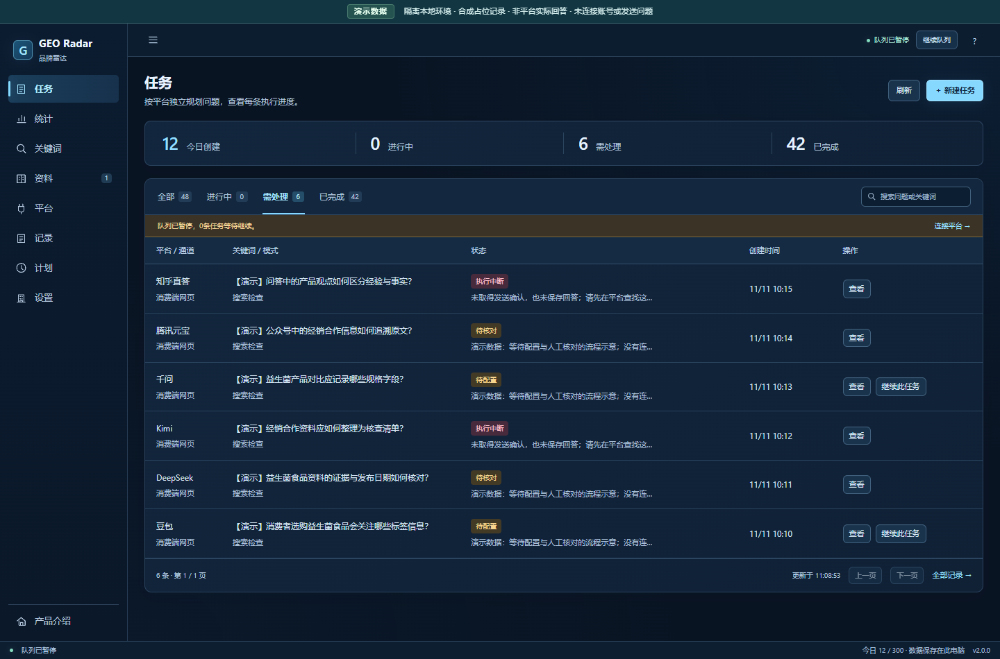
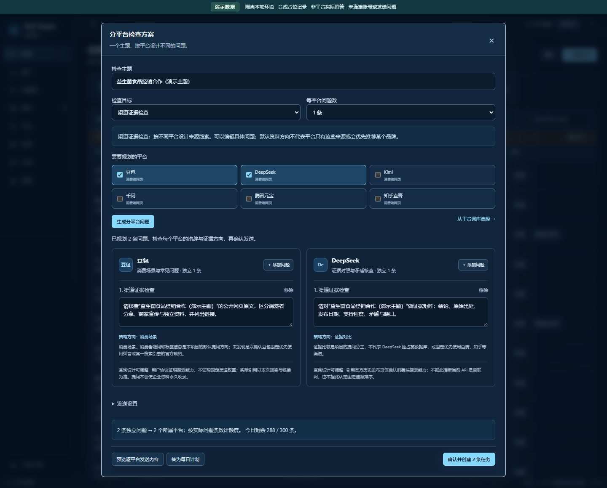
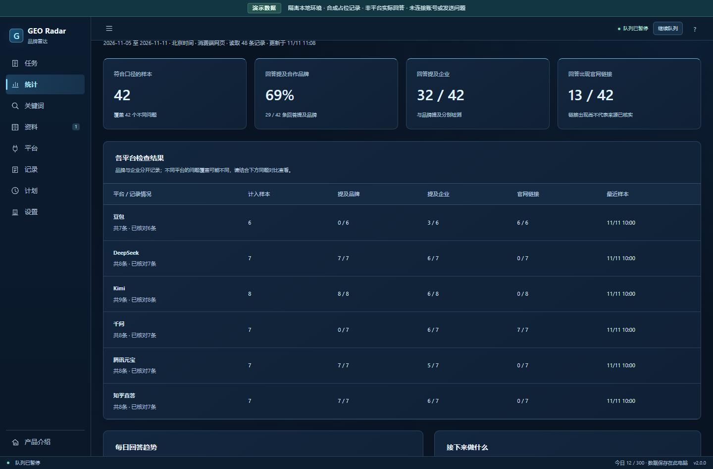
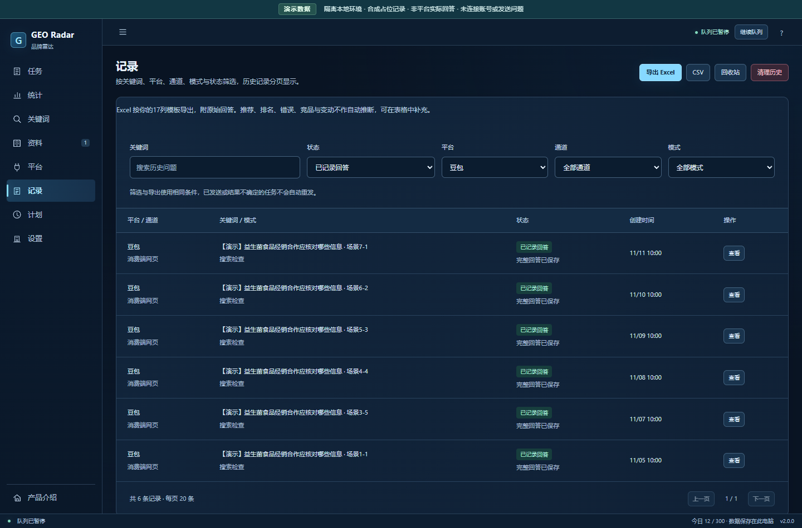
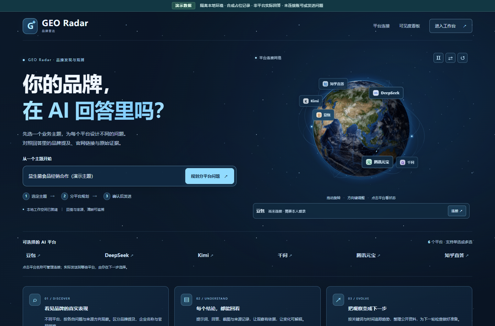
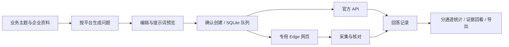

# GEO Radar · 品牌雷达

**分平台问题规划 · 回答证据留存 · 品牌可见度观察**



    

面向生成式搜索的多平台品牌可见度观察工作台。围绕一个业务主题，为豆包、DeepSeek、Kimi、千问、腾讯元宝和知乎直答分别规划问题，保存实际提示词、回答、截图与来源，让每一次观察都有可回看的依据。

[界面预览](#界面预览) · [核心能力](#核心能力) · [快速开始](#快速开始) · [完整使用说明](AI-GEO-workspace/README.md) · [架构与指标](AI-GEO-workspace/docs/architecture.md)

## 界面预览

以下均是项目真实页面，使用隔离的演示企业、演示记录与统计占位内容。图中的回答与数字用于展示界面，不代表真实平台结果或品牌效果。[截图生成说明](AI-GEO-workspace/docs/images/showcase/README.md)

### 01 / 工作区：每条任务，都有明确状态



进行中、需处理、已完成分组，配合关键词搜索与分页，查看任务所属平台、问题与状态。不同平台可并行，同一平台按序执行。

### 02 / 问题规划：一个主题，拆成不同问题



六个平台独立维护问题卡片，可逐条修改、移除并预览完整提示词。每批最多 30 条，每个平台最多 5 条，确认创建后才提交执行任务。

### 03 / 可见度观察：分清品牌、企业与链接



按时间、平台、通道与统计范围查看样本、趋势和回答证据。自然发现、品牌核对与来源核验分别解释，网页与 API 分开统计。

### 04 / 记录与导出：保留完整观察链路



按问题、状态、平台和通道筛选记录，回看实际提示词、回答与来源；Excel 附原始回答，CSV 与 Markdown 报告可单独导出。清理后的记录可以恢复。

### 05 / 产品首页：从一个业务主题开始



地球与平台节点展示本机连接状态。影像和轨道是本地视觉演示，实际执行对象以已确认的问题卡片为准。

## v2.0.1 可靠性更新

修复豆包虚拟列表导致原问题缺失、回答无法关联的情况；补齐DeepSeek非原生新对话入口识别。识别登录、安全验证和限流后暂停自动操作，连接失败退避，保留已有登录窗口与用户草稿。[更新与验证说明](AI-GEO-workspace/docs/platform-reliability-v201.md)

## 核心能力

| 能力 | 具体实现 |
| --- | --- |
| 分平台问题规划 | 六个平台独立词库、本地模板、问题编辑与完整提示词预览 |
| 三种观察目标 | 自然发现、品牌信息核对、来源核验，使用不同问题与统计口径 |
| 网页与 API 通道 | 专用 Edge 会话、本人登录与控件标定；四个平台的官方 API 适配 |
| 任务执行与恢复 | SQLite 队列、同平台顺序执行、跨平台并行、间隔与额度控制、幂等批次 |
| 证据留存与核对 | 保存实际提示词、回答、截图、来源及发送阶段，支持采集校验与人工核对 |
| 观察、计划与导出 | 品牌／企业／官网链接统计，每日问题整理与计划快照，Excel／CSV／Markdown 导出 |

### 平台与通道

| 平台 | 网页通道 | 官方 API 通道 | 默认问题方向 |
| --- | :---: | :---: | --- |
| 豆包 | ✓ | 火山方舟 | 消费选择与常见疑问 |
| DeepSeek | ✓ | ✓ | 原始证据与比较依据 |
| Kimi | ✓ | Moonshot | 文档研究与信息缺口 |
| 千问 | ✓ | DashScope | 产品规格与选品比较 |
| 腾讯元宝 | ✓ | — | 微信生态可访问公开线索 |
| 知乎直答 | ✓ | — | 问答观点与原始依据 |

提问方向是本项目的查询设计，不是平台独占信源或推荐权重。网页通道需要本人登录和校准，API 需要对应 Key 与可用模型；适配范围不代表六个平台均已完成实站端到端发送验收。[平台策略与证据](AI-GEO-workspace/docs/platform-strategies.md)

## 工作流程



| 目标 | 适合的问题 | 统计口径 |
| --- | --- | --- |
| 自然发现 | 不给出企业、品牌与官网，观察行业问题会出现什么 | 符合口径的独立、已核对非空回答 |
| 品牌信息核对 | 直接询问品牌名称、运营企业和公开介绍 | 与自然发现分开 |
| 来源核验 | 追溯主体、日期、原文与链接 | 不计入自然发现 |

## 快速开始

需要 **Windows 10/11、Python 3.10–3.13 和 Microsoft Edge**。这是源码应用，首次安装依赖需要网络。

```powershell
git clone https://github.com/keke152/geo-radar.git
cd geo-radar\AI-GEO-workspace
.\start.bat
```

也可以下载 ZIP，进入 `AI-GEO-workspace` 目录，双击 `start.bat` 或 `open_client.bat`。后台就绪后打开 Edge 应用窗口，本机地址为 [http://127.0.0.1:8020/](http://127.0.0.1:8020/)。

1. **准备资料**：确认企业、品牌与官网，逐条核准允许外发的资料卡。
2. **连接平台**：本人在专用 Edge 登录，检查输入框、发送方式和新对话入口并保存。
3. **规划问题**：填写主题、选择目标与平台，逐条编辑问题，预览实际提示词。
4. **执行与回看**：确认创建后进入队列，在记录与统计中核对回答、来源和样本口径。

本地规划与预览不调用模型；外部执行需要对应的平台配置。每日执行计划保存后默认不启用，核对问题快照后再启用。

<details>
<summary>API 配置与后台控制</summary>

复制 `AI-GEO-workspace/.env.example` 为同目录下的 `AI-GEO-workspace/.env`，只在本机填写需要的 `ARK_API_KEY`、`DEEPSEEK_API_KEY`、`MOONSHOT_API_KEY` 或 `DASHSCOPE_API_KEY`，重启后在平台页选择 API 通道及实际可用的模型 ID。

API 与消费端网页能力分别解释，API 不一定具备 App 的联网工具。`open_browser.bat` 使用普通浏览器；`stop_background.bat` 临时停止后台；`disable_autostart.bat` 取消登录自启并停止后台。升级时保留本机 `runtime` 与 `.env`。[后台说明](AI-GEO-workspace/docs/background-service.md)

</details>

## 工程结构与验证

```text
AI-GEO-workspace/
├─ app.py / config.py          HTTP 接口、配置与产品信息
├─ platform_planner.py         分平台词库、问题与每日计划
├─ engine.py / storage.py      任务队列、调度与 SQLite 持久化
├─ browser_bridge.py           专用 Edge 会话与网页采集
├─ providers.py                官方 API 适配
├─ insights.py                 统计口径与观察报告
├─ record_export.py            Excel 模板与原始回答导出
├─ static/                     客户端界面、地球场景与交互
├─ tests/                      隔离 HTTP、DOM 与交互回归
└─ docs/                       架构、使用说明与界面截图
```

当前本地验证：**239 项单元／HTTP 测试通过**；另有 **6 项提交交互测试、21 个回答关联场景、12 个编辑器内容场景和 4 个空欢迎页场景**通过。截图来自隔离数据库和本地页面，未发送真实平台问题。

```powershell
# 在 AI-GEO-workspace 目录执行
.\.venv\Scripts\python -m unittest discover -s tests -p "test_*.py" -v
.\.venv\Scripts\python tests\ui_submission_checks.py
.\.venv\Scripts\python tests\showcase_capture.py
```

2026-11-11 已修复定时调度异常退出、提交期间草稿丢失、刷新重试重复创建、Host 校验与特殊字符 Excel 导出问题。[检查与优化记录](AI-GEO-workspace/docs/project-review-2026-11-11.md)

## 使用与指标边界

- 问题草案来自本地模板，不是实时热词、搜索量或平台排名分析。
- 名称出现代表文本提及；正文官网地址不等于来源引用；发送资料不代表永久收录。
- 自动校验检查回答对应与生成结束状态，不验证回答中的事实。不同措辞、网页／API 以及引导样本分别解释。
- 当前是绑定 `127.0.0.1` 的本机单用户工作台。关机、休眠或退出登录期间不运行；验证码与登录失效由本人处理。

## 文档与其他项目

[完整使用说明](AI-GEO-workspace/README.md) · [架构与指标](AI-GEO-workspace/docs/architecture.md) · [分平台策略](AI-GEO-workspace/docs/platform-strategies.md) · [记录、导出与回收站](AI-GEO-workspace/docs/records-export-and-trash.md) · [截图复现说明](AI-GEO-workspace/docs/images/showcase/README.md)

本仓库由原 `keke152/code` 更名，保留既有提交与三个旧项目目录；这三个项目继续在各自的独立仓库维护：

| 项目 | 独立仓库 |
| --- | --- |
| Commerce Insight · 知购 | [commerce-insight](https://github.com/keke152/commerce-insight) |
| Thesis Agent Workbench · 学术同行 | [thesis-agent-workbench](https://github.com/keke152/thesis-agent-workbench) |
| AlphaLens Stock Lab | [alphalens-stock-lab](https://github.com/keke152/alphalens-stock-lab) |
